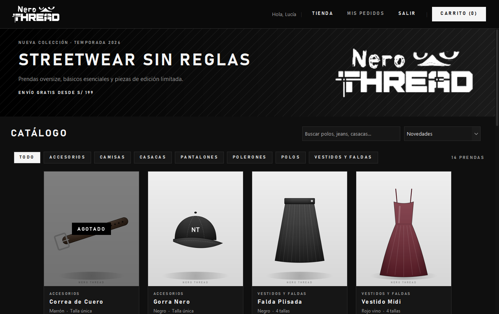
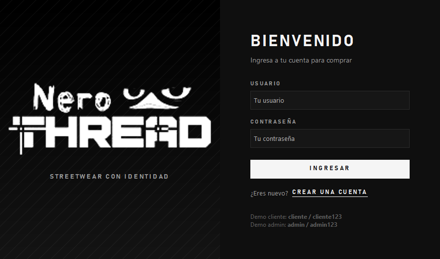
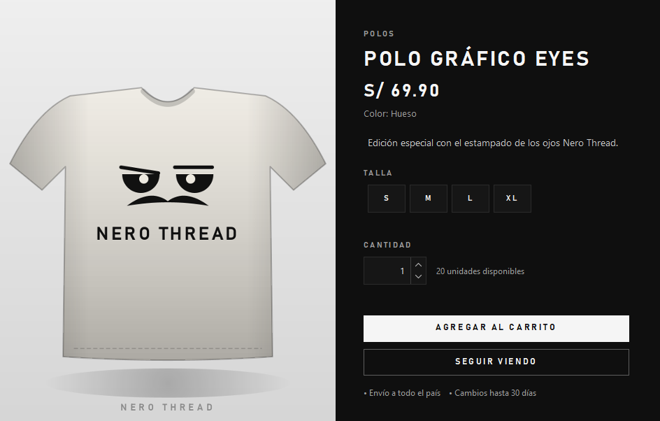
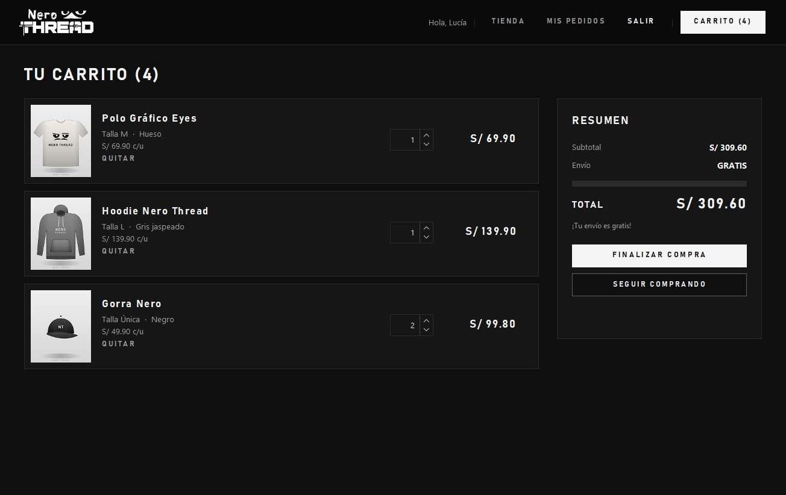
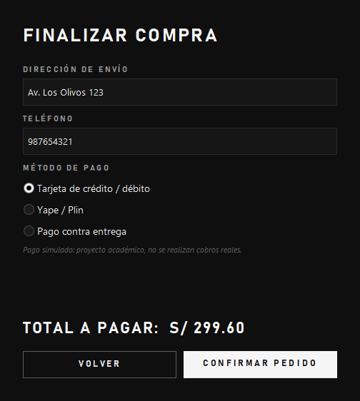
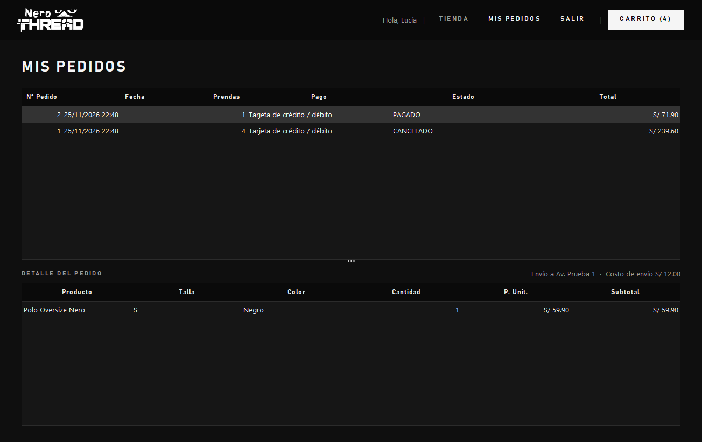
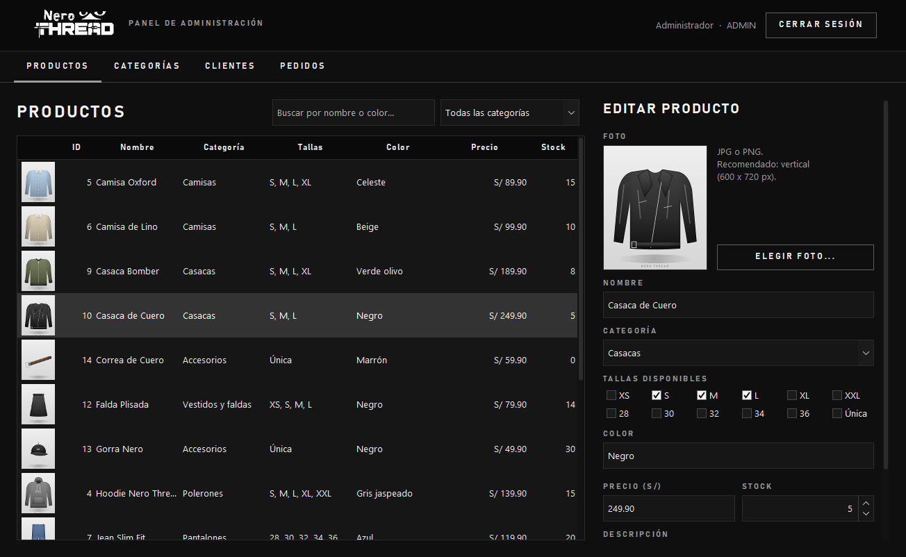

# Nero Thread 🖤 — Tienda virtual de ropa

Aplicación de escritorio de la tienda de ropa **Nero Thread**: los clientes ven el catálogo con fotos, eligen talla, arman su carrito y hacen pedidos. El administrador gestiona productos (con foto), categorías, clientes y pedidos.

Proyecto del curso **Lenguajes de Programación 3**.

- **Lenguaje:** Java 17
- **Interfaz gráfica:** Java Swing + [FlatLaf](https://www.formdev.com/flatlaf/) con un tema monocromático propio (negro y blanco, como el logo)
- **Patrón de diseño:** MVC (Modelo – Vista – Controlador) + DAO + Observer (carrito)
- **Base de datos:** SQLite (por defecto, sin instalación) o MySQL 8
- **Gestor de dependencias:** Maven



> 📘 **¿Vas a estudiar o modificar el código?** Lee la [Guía de estudio](docs/GUIA_DE_ESTUDIO.md): arquitectura, recorridos paso a paso, recetas de modificación y preguntas frecuentes.

## Funcionalidades

### Tienda (cliente)
| Pantalla | Descripción |
|---|---|
| **Login / Registro** | Inicio de sesión y creación de cuenta. Las contraseñas se guardan cifradas (SHA-256). |
| **Catálogo** | Grilla de productos con fotos que se adapta al ancho de la ventana. Filtros por categoría, búsqueda en vivo y orden (novedades, precio, nombre). Marca los productos **agotados**. |
| **Detalle de producto** | Foto grande, descripción, selección de **talla** y cantidad, y aviso de "últimas unidades". |
| **Carrito** | Miniaturas, cambio de cantidades, quitar prendas, subtotal, **envío gratis desde S/ 199** (si no, S/ 12) y total. |
| **Checkout** | Dirección, teléfono y método de pago (tarjeta, Yape/Plin o contra entrega; **pago simulado**). El pedido se guarda en una **transacción**: si otra persona compró la última unidad, no se guarda nada. |
| **Mis pedidos** | Historial de compras con estado y detalle. |

### Panel de administración
| Pestaña | Descripción |
|---|---|
| **Productos** | CRUD con **subida de foto** (JPG/PNG), tallas disponibles, precio y stock. Eliminación lógica. |
| **Categorías** | CRUD (no permite borrar categorías con productos). |
| **Clientes** | CRUD de clientes; indica quién tiene cuenta en la tienda. |
| **Pedidos** | Lista de todos los pedidos, detalle y cambio de estado (PENDIENTE, PAGADO, ENVIADO, ENTREGADO, CANCELADO). Al **cancelar**, las prendas vuelven al stock. |

## Usuarios de prueba

| Usuario | Contraseña | Abre |
|---|---|---|
| `cliente` | `cliente123` | La tienda |
| `admin` | `admin123` | El panel de administración |

También puedes crear tu propia cuenta con **"Crear una cuenta"** en el login.

## Cómo ejecutar

### Opción 1: IntelliJ IDEA / NetBeans (recomendado)
1. `File > Open` y selecciona la carpeta del proyecto (el IDE detecta el `pom.xml`).
2. Espera a que Maven descargue las dependencias.
3. Verifica que el proyecto use **JDK 17** (`File > Project Structure > SDK`).
4. Ejecuta la clase `com.neroshop.Main`.

### Opción 2: Maven por consola
```bash
mvn compile exec:java
```
Para generar un `.jar` ejecutable:
```bash
mvn package
java -jar target/neroshop-1.0.0-jar-with-dependencies.jar
```

La primera vez se crea el archivo `nerothread.db` con las tablas y los datos de ejemplo: 14 productos con foto, 7 categorías y clientes de prueba. Para empezar de cero, borra ese archivo.

## Usar MySQL en lugar de SQLite

1. Ejecuta el script [`database/neroshop_mysql.sql`](database/neroshop_mysql.sql) en MySQL Workbench (crea la base `nerothread`).
2. Copia `src/main/resources/db.properties` a la carpeta raíz del proyecto (junto a `pom.xml`).
3. En esa copia comenta las líneas de SQLite, descomenta las de MySQL y pon tu usuario y contraseña.
4. Ejecuta la aplicación: los datos de ejemplo y los usuarios se insertan solos.

> El archivo `db.properties` de la raíz está en `.gitignore` para no subir tu contraseña a GitHub.

## Fotos de los productos

- Las fotos de ejemplo están en `src/main/resources/imagenes/productos/` (ilustraciones generadas con Java2D al estilo de una foto de estudio).
- Desde el **panel admin → Productos → "Elegir foto..."** puedes subir fotos reales. Se copian a la carpeta `imagenes/productos/` del proyecto y la ruta se guarda en la base de datos.

## Arquitectura MVC

```
src/main/java/com/neroshop/
├── Main.java                     → Punto de entrada
├── config/ConexionBD.java        → Conexión JDBC (Singleton) e inicialización de la BD
├── model/                        → MODELO: entidades y reglas de negocio
│   ├── Usuario, Cliente, Categoria, Producto, Pedido, DetallePedido
│   ├── Carrito.java              → Lógica del carrito (stock, envío, total) + Observer
│   └── dao/                      → Acceso a datos (SQL con PreparedStatement)
│       ├── BaseDAO, DAOException
│       └── UsuarioDAO, ClienteDAO, CategoriaDAO, ProductoDAO, PedidoDAO
├── view/                         → VISTA: solo componentes Swing, sin SQL
│   ├── Estilos.java              → Tema de la marca, tipografía y fábricas de componentes
│   ├── LoginView, RegistroDialog
│   ├── componentes/              → ImagenProducto, GrillaPanel, AnchoAjustable
│   ├── tienda/                   → TiendaView, CatalogoPanel, ProductoCard,
│   │                               ProductoDetalleDialog, CarritoPanel, CheckoutDialog, MisPedidosPanel
│   └── admin/                    → AdminView, ProductoAdminPanel, CategoriaPanel,
│                                   ClientePanel, PedidosAdminPanel
├── controller/                   → CONTROLADOR: eventos, validaciones y flujo
│   ├── LoginController           → Login, registro y redirección según el rol
│   ├── TiendaController          → Navegación, catálogo y detalle
│   ├── CarritoController         → Carrito y checkout
│   ├── MisPedidosController
│   ├── AdminController           → Pestañas del panel admin
│   └── ProductoController, CategoriaController, ClienteController, PedidosAdminController
└── util/                         → Seguridad (hash), Formato (moneda/fecha), Imagenes (carga y escalado)
```

**Flujo:** el usuario interactúa con la **Vista** → el **Controlador** escucha el evento, valida los datos y llama al **Modelo** (DAO o Carrito) → el modelo consulta la base de datos o aplica la regla de negocio → el Controlador actualiza la Vista.

## Modelo de datos

```
usuarios       (id, username, password_hash, nombre, rol)
clientes       (id, usuario_id → usuarios, nombres, apellidos, documento, email, telefono, direccion)
categorias     (id, nombre, descripcion)
productos      (id, nombre, descripcion, categoria_id → categorias, tallas, color, precio, stock, imagen, activo)
pedidos        (id, cliente_id → clientes, fecha, subtotal, envio, total, estado, metodo_pago, direccion_envio, telefono)
detalle_pedido (id, pedido_id → pedidos, producto_id → productos, talla, cantidad, precio_unitario, subtotal)
```

> Simplificación: el stock es por producto (no por talla).

## Capturas

| Login | Detalle de producto |
|---|---|
|  |  |
| **Carrito** | **Checkout** |
|  |  |
| **Mis pedidos** | **Admin: productos** |
|  |  |

## ¿Por qué Swing + FlatLaf?

Swing viene incluido en el JDK y es lo que se enseña en el curso, pero su apariencia por defecto se ve antigua. **FlatLaf** es solo un *Look and Feel*: el código sigue siendo 100 % Swing (`JFrame`, `JTable`, `JButton`...), pero permite un diseño moderno. Sobre él se definió la identidad de Nero Thread en `view/Estilos.java`.
