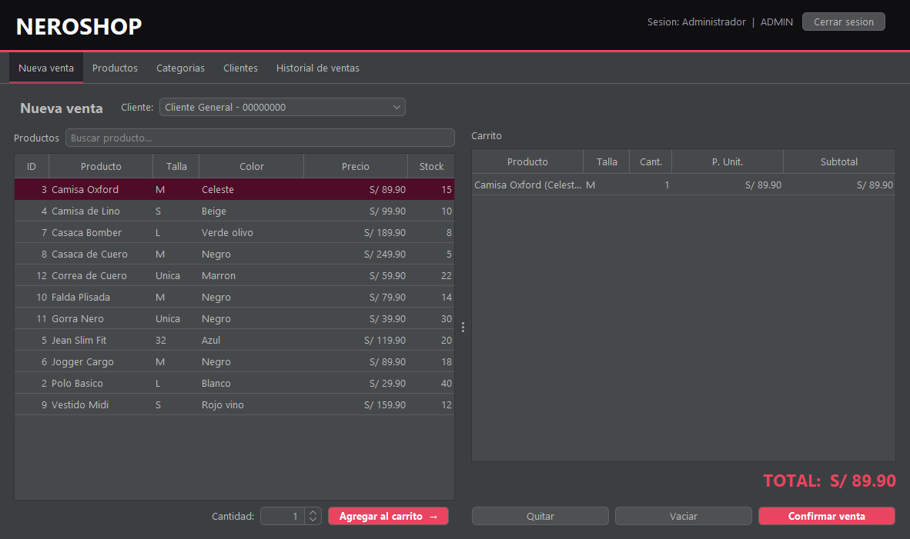
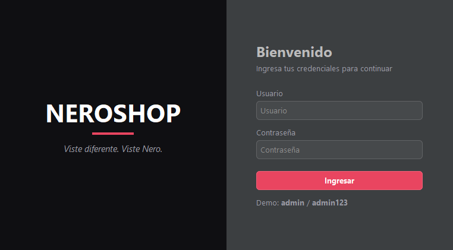
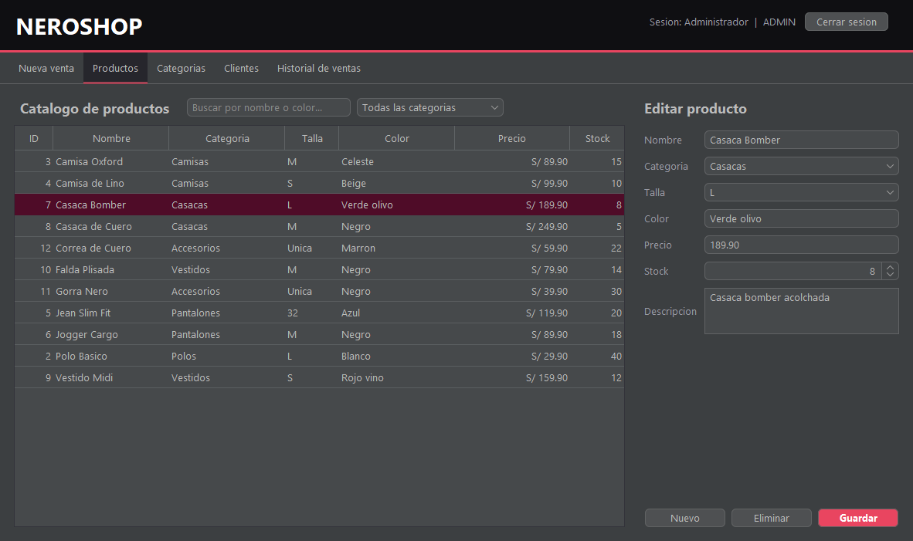
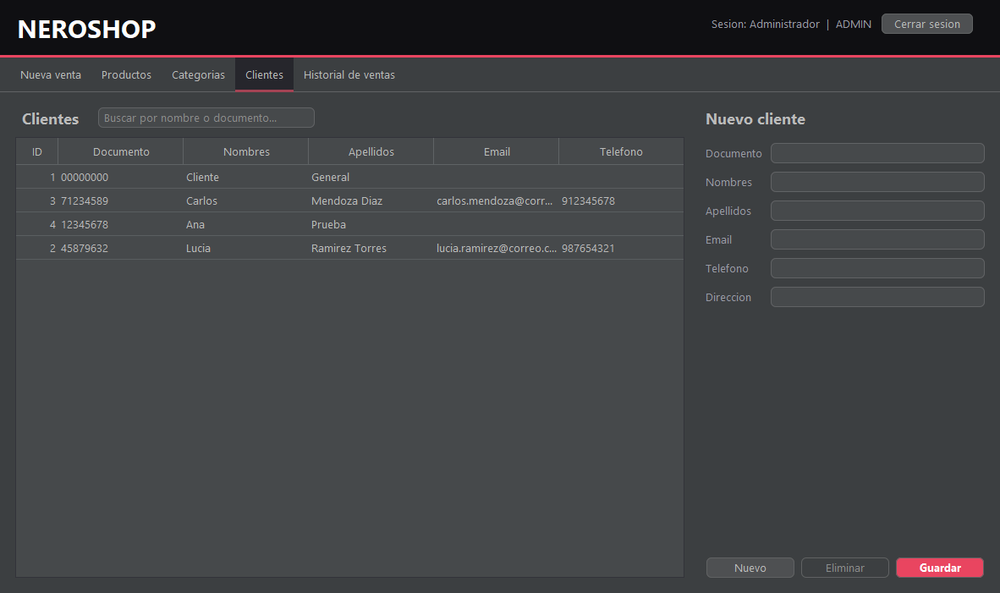
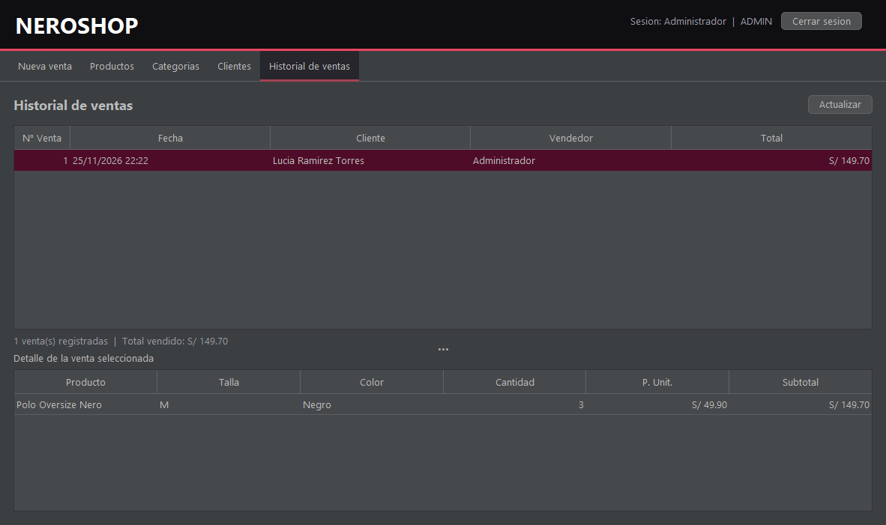

# NeroShop 🖤

Aplicativo de escritorio para la gestión de **NeroShop**, una tienda online de ropa.
Proyecto del curso **Lenguajes de Programación 3**.

- **Lenguaje:** Java 17
- **Interfaz gráfica:** Java Swing + [FlatLaf](https://www.formdev.com/flatlaf/) (tema oscuro moderno)
- **Patrón de diseño:** MVC (Modelo – Vista – Controlador) + DAO
- **Base de datos:** SQLite (por defecto, sin instalación) o MySQL 8
- **Gestor de dependencias:** Maven



## Funcionalidades

| Módulo | Descripción |
|---|---|
| **Login** | Inicio de sesión con contraseñas cifradas (SHA-256). |
| **Nueva venta** | Punto de venta: buscar productos, armar el carrito, elegir cliente y confirmar. Descuenta stock automáticamente usando una **transacción** (si algo falla no se guarda nada). |
| **Productos** | CRUD de prendas con talla, color, precio y stock. Búsqueda en vivo y filtro por categoría. Eliminación lógica para conservar el historial. |
| **Categorías** | CRUD de categorías (no permite borrar una categoría con productos). |
| **Clientes** | CRUD de clientes con validación de documento y email. |
| **Historial de ventas** | Lista de ventas con su detalle y total vendido. |

## Usuarios de prueba

| Usuario | Contraseña | Rol |
|---|---|---|
| `admin` | `admin123` | ADMIN |
| `vendedor` | `vendedor123` | VENDEDOR |

## Cómo ejecutar

### Opción 1: IntelliJ IDEA / NetBeans (recomendado)
1. `File > Open` y selecciona la carpeta del proyecto (el IDE detecta el `pom.xml`).
2. Espera a que Maven descargue las dependencias.
3. Ejecuta la clase `com.neroshop.Main`.

### Opción 2: Maven por consola
```bash
mvn compile exec:java
```
Para generar un `.jar` ejecutable:
```bash
mvn package
java -jar target/neroshop-1.0.0-jar-with-dependencies.jar
```

La primera vez se crea el archivo `neroshop.db` con las tablas y datos de ejemplo (12 productos, 6 categorías y 3 clientes).

## Usar MySQL en lugar de SQLite

1. Ejecuta el script [`database/neroshop_mysql.sql`](database/neroshop_mysql.sql) en MySQL Workbench.
2. Copia `src/main/resources/db.properties` a la carpeta raíz del proyecto (junto a `pom.xml`).
3. En esa copia comenta las líneas de SQLite, descomenta las de MySQL y pon tu usuario y contraseña.
4. Ejecuta la aplicación: los datos de ejemplo y los usuarios se insertan solos.

> El archivo `db.properties` de la raíz está en `.gitignore` para no subir tu contraseña a GitHub.

## Arquitectura MVC

```
src/main/java/com/neroshop/
├── Main.java                  → Punto de entrada
├── config/
│   └── ConexionBD.java        → Conexión JDBC (Singleton) e inicialización de la BD
├── model/                     → MODELO: entidades y reglas de negocio
│   ├── Usuario, Categoria, Producto, Cliente, Venta, DetalleVenta
│   ├── Carrito.java           → Lógica del carrito (stock, total)
│   └── dao/                   → Acceso a datos (SQL con PreparedStatement)
│       ├── BaseDAO, DAOException
│       └── UsuarioDAO, CategoriaDAO, ProductoDAO, ClienteDAO, VentaDAO
├── view/                      → VISTA: solo componentes Swing, sin lógica ni SQL
│   ├── Estilos.java           → Tema, colores y fábricas de componentes
│   ├── LoginView, MainView
│   └── VentaPanel, ProductoPanel, CategoriaPanel, ClientePanel, HistorialPanel
├── controller/                → CONTROLADOR: eventos, validaciones y conexión vista-modelo
│   ├── LoginController, MainController
│   └── VentaController, ProductoController, CategoriaController,
│       ClienteController, HistorialController
└── util/                      → Seguridad (hash), Formato (moneda y fechas)
```

**Flujo:** el usuario interactúa con la **Vista** → el **Controlador** escucha el evento, valida los datos y llama al **Modelo** (DAO) → el DAO consulta la base de datos y devuelve objetos → el Controlador actualiza la Vista.

## Modelo de datos

```
usuarios (id, username, password_hash, nombre, rol)
categorias (id, nombre, descripcion)
productos (id, nombre, descripcion, categoria_id → categorias, talla, color, precio, stock, activo)
clientes (id, nombres, apellidos, documento, email, telefono, direccion)
ventas (id, cliente_id → clientes, usuario_id → usuarios, fecha, total)
detalle_venta (id, venta_id → ventas, producto_id → productos, cantidad, precio_unitario, subtotal)
```

## Capturas

| Login | Productos |
|---|---|
|  |  |
| **Clientes** | **Historial** |
|  |  |

## ¿Por qué Swing + FlatLaf?

Swing viene incluido en el JDK y es lo que se enseña en el curso, pero su apariencia por defecto se ve antigua. **FlatLaf** es solo un *Look and Feel*: el código sigue siendo 100 % Swing (`JFrame`, `JTable`, `JButton`...), pero con un diseño moderno. La alternativa sería **JavaFX**, que tiene mejores gráficos y estilos con CSS, aunque requiere configuración adicional (no viene en el JDK desde Java 11).

> La moneda se puede cambiar en `util/Formato.java` (constante `MONEDA`).
