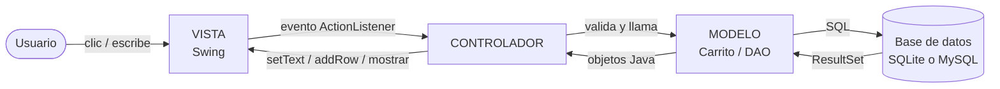
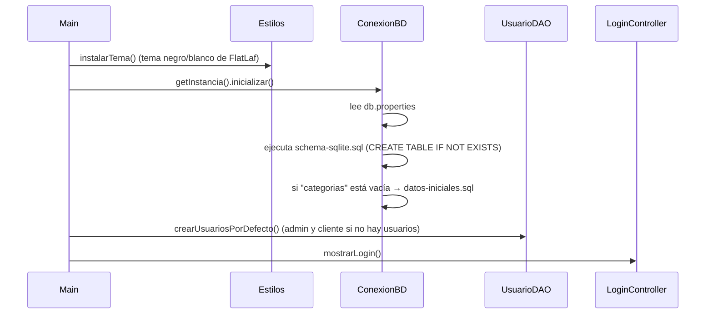
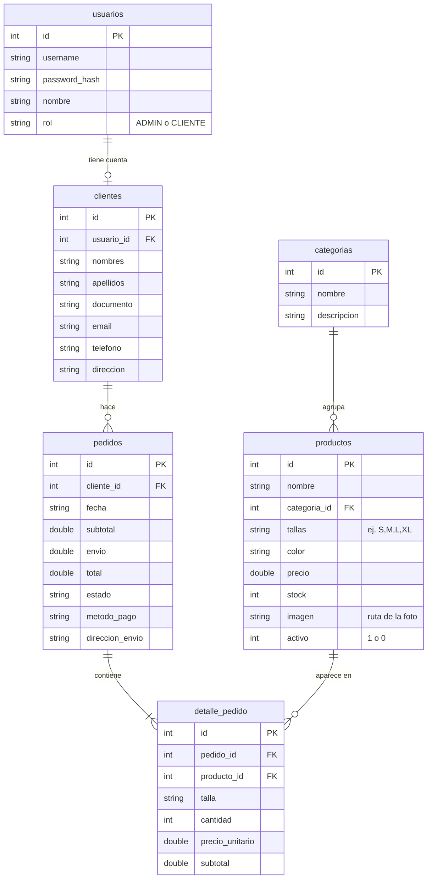
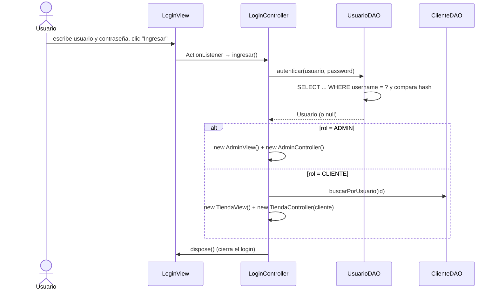
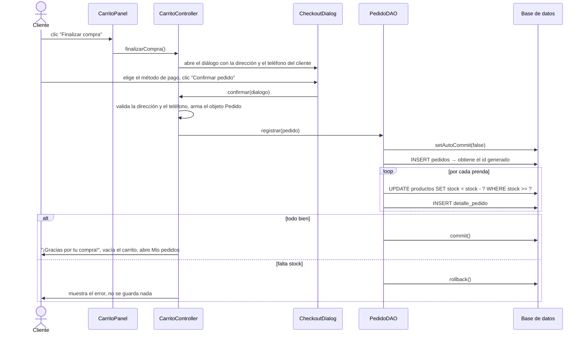

# Guía de estudio: Nero Thread

Esta guía sirve para entender **todo** el código de la tienda y poder modificarlo con seguridad en la exposición.
Léela en orden: primero el mapa general, luego los recorridos y al final las recetas de modificación.

> Consejo: abre los archivos en IntelliJ mientras lees. Con **Ctrl + clic** sobre un método saltas a su definición,
> y con **Alt + F7** ves desde dónde se usa.

---

## Índice

1. [El mapa general (MVC)](#1-el-mapa-general-mvc)
2. [Cómo arranca la aplicación](#2-cómo-arranca-la-aplicación)
3. [Conceptos y patrones que usa el proyecto](#3-conceptos-y-patrones-que-usa-el-proyecto)
4. [La base de datos](#4-la-base-de-datos)
5. [Capa MODELO, archivo por archivo](#5-capa-modelo-archivo-por-archivo)
6. [Capa VISTA, archivo por archivo](#6-capa-vista-archivo-por-archivo)
7. [Capa CONTROLADOR, archivo por archivo](#7-capa-controlador-archivo-por-archivo)
8. [Recorridos completos (paso a paso)](#8-recorridos-completos-paso-a-paso)
9. [Recetas: cómo hacer modificaciones](#9-recetas-cómo-hacer-modificaciones)
10. [Preguntas que les pueden hacer](#10-preguntas-que-les-pueden-hacer)
11. [Problemas comunes y cómo resolverlos](#11-problemas-comunes-y-cómo-resolverlos)
12. [Plan para repartir el estudio en el grupo](#12-plan-para-repartir-el-estudio-en-el-grupo)

---

## 1. El mapa general (MVC)

El proyecto está dividido en **tres capas** que no se mezclan:

| Capa | Paquete | Qué hace | Qué **NO** hace |
|---|---|---|---|
| **Modelo** | `model` y `model.dao` | Guarda los datos (Producto, Pedido...), aplica reglas de negocio (stock, envío) y habla con la base de datos | No sabe nada de ventanas ni botones |
| **Vista** | `view` | Dibuja las ventanas con Swing y ofrece *getters* de sus botones y campos | No hace SQL ni toma decisiones |
| **Controlador** | `controller` | Escucha los clics, valida lo que escribió el usuario, llama al modelo y actualiza la vista | No dibuja componentes ni escribe SQL |



**Regla para recordar:** la vista *muestra*, el controlador *decide* y el modelo *sabe*.

### Estructura de carpetas

```
src/main/java/com/neroshop/
├── Main.java                 ← punto de entrada
├── config/ConexionBD.java    ← conexión a la base de datos
├── model/                    ← MODELO
│   ├── Usuario, Cliente, Categoria, Producto, Pedido, DetallePedido   (entidades)
│   ├── Carrito.java          (lógica del carrito)
│   └── dao/                  (acceso a datos: SQL)
├── view/                     ← VISTA
│   ├── Estilos.java          (colores, fuentes, botones de la marca)
│   ├── LoginView, RegistroDialog, PanelBase
│   ├── componentes/          (piezas reutilizables)
│   ├── tienda/               (pantallas del cliente)
│   └── admin/                (pantallas del administrador)
├── controller/               ← CONTROLADOR
└── util/                     ← utilidades (hash, formato de moneda, imágenes)

src/main/resources/
├── db.properties             ← qué base de datos usar
├── sql/schema-sqlite.sql     ← CREATE TABLE
├── sql/datos-iniciales.sql   ← productos y clientes de ejemplo
└── imagenes/                 ← logo, ícono y fotos de productos
```

---

## 2. Cómo arranca la aplicación

Archivo: [`Main.java`](../src/main/java/com/neroshop/Main.java)



Puntos clave:
- `Estilos.instalarTema()` se llama **antes** de crear cualquier ventana; si no, Swing usa el aspecto antiguo.
- `SwingUtilities.invokeLater(...)`: en Swing, todo lo que toca la interfaz debe ejecutarse en el **hilo de eventos (EDT)**. Por eso el arranque va dentro de `invokeLater`.
- El *shutdown hook* (`Runtime.getRuntime().addShutdownHook`) cierra la conexión cuando se cierra el programa.

---

## 3. Conceptos y patrones que usa el proyecto

| Concepto | Dónde está | Explicación corta |
|---|---|---|
| **MVC** | Todo el proyecto | Separar datos, pantalla y lógica de control. |
| **DAO** (Data Access Object) | `model/dao/*DAO.java` | Una clase por tabla que encapsula el SQL. El resto del programa nunca escribe SQL. |
| **Singleton** | `ConexionBD.getInstancia()` | Solo existe **una** instancia de la conexión en todo el programa (constructor `private` + método estático). |
| **Observer** | `Carrito.alCambiar(...)` | El carrito avisa a quien lo "observa" cuando cambia. Así el botón "CARRITO (3)" y la pantalla del carrito se actualizan solos. |
| **Herencia** | `BaseDAO`, `PanelBase` | Los DAO heredan `conexion()`; los paneles heredan `mostrarError()` y `confirmar()`. |
| **Interfaces** | `Refrescable`, `CarritoPanel.Acciones` | Un contrato: "toda clase que implemente esto tiene `refrescar()`". |
| **Transacción** | `PedidoDAO.registrar`, `UsuarioDAO.registrarCliente` | `setAutoCommit(false)` → varias sentencias → `commit()`; si algo falla → `rollback()`. O se guarda todo, o nada. |
| **PreparedStatement** | Todos los DAO | Consultas con `?` en vez de concatenar texto. Evita **inyección SQL** y errores con comillas. |
| **Eliminación lógica** | `ProductoDAO.eliminar` | No se borra el producto: se pone `activo = 0`. Así los pedidos antiguos siguen mostrando ese producto. |
| **Hash de contraseñas** | `util/Seguridad.java` | Se guarda el SHA-256 de la contraseña, nunca la contraseña real. |
| **Excepción propia** | `DAOException` | Convierte errores técnicos de SQL en mensajes que el usuario entiende. |
| **Lambdas** | `btn.addActionListener(e -> guardar())` | Forma corta de escribir un `ActionListener`. |
| **CardLayout** | `TiendaView`, `CarritoPanel` | Varias "pantallas" apiladas; se muestra una a la vez (catálogo, carrito, pedidos). |
| **LayoutManager propio** | `componentes/GrillaPanel.java` | Calcula cuántas tarjetas caben por fila según el ancho de la ventana. |
| **Enum** | `ProductoDAO.Orden` | Las opciones de orden del catálogo, cada una con su texto y su `ORDER BY`. |

---

## 4. La base de datos



- **¿Por qué `detalle_pedido` guarda `precio_unitario`?** Porque si mañana cambia el precio del producto, el pedido antiguo debe seguir mostrando el precio al que se compró.
- **¿Por qué `tallas` es texto "S,M,L"?** Simplificación: el stock es por producto, no por talla. `Producto.getListaTallas()` convierte ese texto en una lista.
- **SQLite vs MySQL:** se elige en [`db.properties`](../src/main/resources/db.properties). Con SQLite las tablas se crean solas; con MySQL se ejecuta antes [`database/neroshop_mysql.sql`](../database/neroshop_mysql.sql). El código Java es el mismo para las dos.

---

## 5. Capa MODELO, archivo por archivo

### Entidades (clases "de datos")
Son clases con atributos privados, *getters* y *setters*. No tienen lógica compleja.

| Clase | Representa | Detalle interesante |
|---|---|---|
| [`Usuario`](../src/main/java/com/neroshop/model/Usuario.java) | Cuenta para iniciar sesión | `rol` decide si abre la tienda o el panel admin |
| [`Cliente`](../src/main/java/com/neroshop/model/Cliente.java) | Datos personales del comprador | `usuarioId` lo une con su cuenta (0 si no tiene) |
| [`Categoria`](../src/main/java/com/neroshop/model/Categoria.java) | Polos, Casacas... | `toString()` devuelve el nombre: así se ve bien en los `JComboBox`. `equals()` compara por `id` |
| [`Producto`](../src/main/java/com/neroshop/model/Producto.java) | Una prenda | `getListaTallas()` y `isAgotado()` |
| [`Pedido`](../src/main/java/com/neroshop/model/Pedido.java) | Una compra | Constantes `ESTADOS` y `METODOS_PAGO` |
| [`DetallePedido`](../src/main/java/com/neroshop/model/DetallePedido.java) | Una línea del pedido o del carrito | `getSubtotal()` = cantidad × precio, redondeado a 2 decimales |

### [`Carrito.java`](../src/main/java/com/neroshop/model/Carrito.java): la lógica de negocio
Es la clase más importante del modelo. Estúdiala bien.

- `agregar(producto, talla, cantidad)`:
  1. Exige talla y cantidad > 0.
  2. Suma lo que ya hay de ese producto **en todas las tallas** (`cantidadDelProducto`) y verifica que no supere el stock.
  3. Si ya existe la misma prenda en la misma talla, **suma la cantidad**; si no, agrega una línea nueva.
  4. Llama a `notificar()` → avisa a los observadores.
- `getEnvio()`: devuelve 0 si el subtotal es ≥ `ENVIO_GRATIS_DESDE` (199); si no, `COSTO_ENVIO` (12).
- Si una regla no se cumple, lanza `IllegalArgumentException` con un mensaje. **El controlador la atrapa y la muestra.**

### Los DAO ([`model/dao`](../src/main/java/com/neroshop/model/dao))
Todos heredan de [`BaseDAO`](../src/main/java/com/neroshop/model/dao/BaseDAO.java), que entrega la conexión con `conexion()`.

Patrón que se repite en todos:
```java
String sql = "SELECT ... WHERE id = ?";
try (PreparedStatement ps = conexion().prepareStatement(sql)) {   // try-with-resources: se cierra solo
    ps.setInt(1, id);                                            // reemplaza el primer "?"
    try (ResultSet rs = ps.executeQuery()) {
        while (rs.next()) {                                      // recorre las filas
            lista.add(mapear(rs));                               // fila → objeto Java
        }
    }
} catch (SQLException e) {
    throw new DAOException("Mensaje entendible", e);
}
```

| DAO | Métodos importantes |
|---|---|
| [`UsuarioDAO`](../src/main/java/com/neroshop/model/dao/UsuarioDAO.java) | `autenticar` (compara hashes), `registrarCliente` (**transacción**: crea usuario + cliente), `crearUsuariosPorDefecto` |
| [`ClienteDAO`](../src/main/java/com/neroshop/model/dao/ClienteDAO.java) | `listar(filtro)`, `buscarPorUsuario`, `validarDocumentoUnico`, `eliminar` (no deja borrar si tiene cuenta o pedidos) |
| [`CategoriaDAO`](../src/main/java/com/neroshop/model/dao/CategoriaDAO.java) | CRUD + no deja borrar categorías con productos |
| [`ProductoDAO`](../src/main/java/com/neroshop/model/dao/ProductoDAO.java) | `listar(filtro, categoriaId, orden)` arma el SQL según los filtros; `buscarPorId` trae el stock actualizado; `eliminar` es lógico |
| [`PedidoDAO`](../src/main/java/com/neroshop/model/dao/PedidoDAO.java) | `registrar` (**transacción** + descuento de stock), `listarPorCliente`, `listarTodos`, `actualizarEstado` (si se cancela, devuelve el stock) |

**El truco anti-sobreventa** en `PedidoDAO.registrar`:
```sql
UPDATE productos SET stock = stock - ? WHERE id = ? AND activo = 1 AND stock >= ?
```
Si el stock no alcanza, el `UPDATE` no modifica ninguna fila (`executeUpdate() == 0`). Entonces se lanza un error y se hace `rollback()`: el pedido no se guarda.

### [`ConexionBD.java`](../src/main/java/com/neroshop/config/ConexionBD.java)
- **Singleton**: constructor `private`, campo `static instancia`, método `getInstancia()`.
- Busca `db.properties` primero en la carpeta del proyecto (para tu MySQL local) y si no existe usa el de `resources`.
- `inicializar()` ejecuta los scripts `.sql` partiéndolos por `;`.

### Utilidades ([`util`](../src/main/java/com/neroshop/util))
- [`Seguridad`](../src/main/java/com/neroshop/util/Seguridad.java): `hash(password)` = SHA-256 de (sal + contraseña) en hexadecimal.
- [`Formato`](../src/main/java/com/neroshop/util/Formato.java): `moneda(59.9)` → `"S/ 59.90"`. **Aquí se cambia el símbolo de moneda.**
- [`Imagenes`](../src/main/java/com/neroshop/util/Imagenes.java): carga fotos (primero del disco, luego de `resources`), las escala con buena calidad y las guarda en caché. `guardarFotoProducto` copia la foto que elige el admin a `imagenes/productos/`.

---

## 6. Capa VISTA, archivo por archivo

Las vistas **solo** crean componentes y ofrecen *getters* (`getBtnGuardar()`, `getTxtNombre()`...) para que el controlador les ponga listeners.

### Base y estilo
- [`Estilos.java`](../src/main/java/com/neroshop/view/Estilos.java): **toda la identidad visual**. Colores (`NEGRO`, `BLANCO`, `GRIS`...), fuentes (`titulo()`, `etiqueta()`), fábricas de botones (`botonPrimario` blanco, `botonSecundario` con borde, `chip` para tallas y categorías) y tablas.
- [`PanelBase.java`](../src/main/java/com/neroshop/view/PanelBase.java): todos los paneles heredan `mostrarMensaje`, `mostrarError` y `confirmar` (usan `JOptionPane`).

### Login
- [`LoginView`](../src/main/java/com/neroshop/view/LoginView.java): mitad izquierda con el logo y mitad derecha con el formulario.
- [`RegistroDialog`](../src/main/java/com/neroshop/view/RegistroDialog.java): formulario de cuenta nueva en dos columnas.

### Componentes reutilizables ([`view/componentes`](../src/main/java/com/neroshop/view/componentes))
- [`ImagenProducto`](../src/main/java/com/neroshop/view/componentes/ImagenProducto.java): un `JComponent` que en `paintComponent` dibuja la foto llenando el espacio, y si tiene "sello" pinta encima "AGOTADO".
- [`GrillaPanel`](../src/main/java/com/neroshop/view/componentes/GrillaPanel.java): layout propio; `columnas = ancho / (anchoTarjeta + espacio)`.
- [`AnchoAjustable`](../src/main/java/com/neroshop/view/componentes/AnchoAjustable.java): implementa `Scrollable` para que el contenido solo se desplace en vertical.

### Tienda ([`view/tienda`](../src/main/java/com/neroshop/view/tienda))
| Vista | Qué muestra |
|---|---|
| `TiendaView` | Ventana principal: cabecera con logo y botones + `CardLayout` con 3 secciones |
| `CatalogoPanel` | Banner, buscador, combo de orden, chips de categorías y la grilla de tarjetas |
| `ProductoCard` | Una tarjeta: foto, categoría, nombre, color y precio. Cambia el borde al pasar el mouse |
| `ProductoDetalleDialog` | Ventana modal con foto grande, tallas, cantidad y "Agregar al carrito" |
| `CarritoPanel` | Filas del carrito + resumen. Define la interfaz `Acciones` que implementa el controlador |
| `CheckoutDialog` | Dirección, teléfono y método de pago |
| `MisPedidosPanel` | Tabla de pedidos + tabla de detalle |

### Admin ([`view/admin`](../src/main/java/com/neroshop/view/admin))
`AdminView` (pestañas) → `ProductoAdminPanel`, `CategoriaPanel`, `ClientePanel`, `PedidosAdminPanel`. Todos siguen el mismo diseño: **tabla a la izquierda y formulario a la derecha**.

---

## 7. Capa CONTROLADOR, archivo por archivo

Todos los controladores siguen la misma estructura:

```java
public class XController {
    private final XPanel vista;      // la vista que controla
    private final XDAO dao;          // el modelo que usa

    public XController(XPanel vista, XDAO dao) {
        this.vista = vista;
        this.dao = dao;
        vista.getBtnGuardar().addActionListener(e -> guardar());   // 1. conectar eventos
        refrescar();                                                // 2. cargar datos
    }

    private void guardar() {
        // 3. leer de la vista  →  4. validar  →  5. llamar al DAO  →  6. actualizar la vista
    }
}
```

| Controlador | Responsabilidad |
|---|---|
| [`LoginController`](../src/main/java/com/neroshop/controller/LoginController.java) | `ingresar()` → `abrirSesion()`: si el rol es ADMIN abre `AdminView`, si es CLIENTE abre `TiendaView`. `crearCuenta()` valida el registro |
| [`TiendaController`](../src/main/java/com/neroshop/controller/TiendaController.java) | Crea el `Carrito` y los otros controladores de la tienda. Maneja la navegación, los filtros y `verDetalle()` |
| [`CarritoController`](../src/main/java/com/neroshop/controller/CarritoController.java) | Dibuja el carrito, cambia cantidades, quita prendas y hace el checkout (`finalizarCompra()` → `confirmar()`) |
| [`MisPedidosController`](../src/main/java/com/neroshop/controller/MisPedidosController.java) | Carga los pedidos del cliente y su detalle |
| [`AdminController`](../src/main/java/com/neroshop/controller/AdminController.java) | Crea los 4 controladores del admin. Al cambiar de pestaña llama a `refrescar()` |
| [`ProductoController`](../src/main/java/com/neroshop/controller/ProductoController.java) | CRUD de productos; `elegirFoto()`; `leerFormulario()` valida y arma el `Producto` |
| [`CategoriaController`](../src/main/java/com/neroshop/controller/CategoriaController.java), [`ClienteController`](../src/main/java/com/neroshop/controller/ClienteController.java) | CRUD |
| [`PedidosAdminController`](../src/main/java/com/neroshop/controller/PedidosAdminController.java) | Lista los pedidos y `cambiarEstado()` |
| [`Validaciones`](../src/main/java/com/neroshop/controller/Validaciones.java) | Expresiones regulares para documento y email (se reutilizan en el registro y en el admin) |
| [`CambioTextoListener`](../src/main/java/com/neroshop/controller/CambioTextoListener.java) | Ejecuta una acción cada vez que cambia el texto (búsqueda en vivo) |

**Selección en tablas:** los controladores guardan la lista que mostraron (`productos`, `clientes`...). Al hacer clic en una fila usan `tabla.convertRowIndexToModel(fila)` porque la tabla puede estar **ordenada** y el índice visual no coincide con el de la lista.

---

## 8. Recorridos completos (paso a paso)

### 8.1 Iniciar sesión


### 8.2 Agregar una prenda al carrito
1. [`CatalogoPanel.setProductos`](../src/main/java/com/neroshop/view/tienda/CatalogoPanel.java) crea una `ProductoCard` por producto y le pasa una acción: `card.alHacerClic(() -> alElegir.accept(p))`.
2. Al hacer clic se ejecuta `TiendaController.verDetalle(producto)`.
3. `verDetalle` vuelve a leer el producto con `productoDAO.buscarPorId` (para tener el **stock actual**) y abre `ProductoDetalleDialog`.
4. Clic en "Agregar al carrito" → `carrito.agregar(producto, talla, cantidad)`.
5. El `Carrito` valida y llama a `notificar()` → se ejecutan los observadores:
   - `TiendaController`: actualiza el botón "CARRITO (n)".
   - `CarritoController.actualizarVista()`: redibuja las filas y los totales.
6. Si `agregar` lanzó una excepción (sin talla, sin stock), el controlador la atrapa y muestra el mensaje.

### 8.3 Comprar (checkout)


### 8.4 Admin: crear un producto con foto
1. `ProductoAdminPanel` → clic "Elegir foto..." → `ProductoController.elegirFoto()`.
2. La vista abre un `JFileChooser` (`elegirArchivoFoto()`), el controlador llama a `Imagenes.guardarFotoProducto(archivo)`, que **copia** la foto a `imagenes/productos/foto-<número>.png` y devuelve esa ruta.
3. Clic "Guardar" → `leerFormulario()` valida nombre, categoría, tallas, color y precio → `productoDAO.insertar(p)`.
4. La próxima vez que el cliente abra la tienda, el producto ya aparece (el catálogo se recarga al volver a "TIENDA").

### 8.5 Admin: cancelar un pedido
`PedidosAdminController.cambiarEstado()` → pide confirmación → `pedidoDAO.actualizarEstado(pedido, "CANCELADO")`. En una transacción cambia el estado y **suma de vuelta** al stock las cantidades de `detalle_pedido`. Un pedido cancelado ya no se puede modificar.

---

## 9. Recetas: cómo hacer modificaciones

> **Importante:** si cambias la **estructura** de una tabla (agregar o quitar columnas), **borra el archivo `nerothread.db`** de la carpeta del proyecto antes de ejecutar. El script usa `CREATE TABLE IF NOT EXISTS` y no modifica tablas que ya existen. Al borrarlo se crea de nuevo con los datos de ejemplo.

### 9.1 Cambiar la moneda, el costo de envío o el monto para envío gratis
- Moneda: [`Formato.java`](../src/main/java/com/neroshop/util/Formato.java) → `MONEDA = "S/ "` (por ejemplo `"$ "`).
- Envío: [`Carrito.java`](../src/main/java/com/neroshop/model/Carrito.java) → `COSTO_ENVIO` y `ENVIO_GRATIS_DESDE`.
- El texto "Envío gratis desde S/ 199" del banner está en `CatalogoPanel.crearBanner()`.

### 9.2 Cambiar textos del banner o los colores
- Textos del banner: `CatalogoPanel.crearBanner()`.
- Colores: constantes al inicio de [`Estilos.java`](../src/main/java/com/neroshop/view/Estilos.java). Por ejemplo, para un acento rojo cambia `BLANCO` en `botonPrimario` por `ROJO`.

### 9.3 Agregar productos o categorías de ejemplo
- **Sin tocar código:** inicia sesión como admin y créalos desde el panel.
- **Para que vengan desde el inicio:** agrega un `INSERT` en [`datos-iniciales.sql`](../src/main/resources/sql/datos-iniciales.sql) y borra `nerothread.db`.

### 9.4 Agregar un método de pago (ej. "Transferencia bancaria")
1. [`Pedido.java`](../src/main/java/com/neroshop/model/Pedido.java) → agrégalo al arreglo `METODOS_PAGO` **al final**.
2. El `CheckoutDialog` crea los botones de opción desde ese arreglo, así que aparece solo.
3. Cuidado: `CarritoController.confirmar()` usa `METODOS_PAGO[2]` ("contra entrega") para poner el estado PENDIENTE. Si cambias el orden, ajusta ese índice.

### 9.5 Agregar un estado de pedido (ej. "EN PREPARACIÓN")
1. `Pedido.java` → crea la constante y agrégala a `ESTADOS`.
2. El combo del admin (`PedidosAdminPanel`) se llena desde `ESTADOS`, así que aparece solo.

### 9.6 Agregar un campo nuevo al producto (ej. "marca") ⭐ el más probable
Es el ejemplo perfecto para mostrar que entienden **las tres capas**:

| Paso | Capa | Archivo | Qué hacer |
|---|---|---|---|
| 1 | BD | `schema-sqlite.sql` y `neroshop_mysql.sql` | Agregar `marca TEXT` / `marca VARCHAR(60)` a la tabla `productos` |
| 2 | BD | `datos-iniciales.sql` | (Opcional) agregar la columna y el valor en los `INSERT` |
| 3 | Modelo | `Producto.java` | `private String marca;` + getter y setter |
| 4 | Modelo | `ProductoDAO.java` | Agregar `p.marca` en `SELECT_BASE`; agregar la columna y un `?` en `insertar` y `actualizar`; `ps.setString(...)` en `llenarParametros` (ojo: se corren los números de `?`, y el `id` del UPDATE pasa a ser el 10); `p.setMarca(rs.getString("marca"))` en `mapear` |
| 5 | Vista | `ProductoAdminPanel.java` | `private final JTextField txtMarca = ...`, `Estilos.agregarCampo(campos, N, "Marca", txtMarca)`, limpiarlo en `limpiarFormulario()` y su getter |
| 6 | Controlador | `ProductoController.java` | En `leerFormulario()`: `p.setMarca(vista.getTxtMarca().getText().trim())`; en `seleccionar()`: `vista.getTxtMarca().setText(...)` |
| 7 | Vista | `ProductoDetalleDialog.java` / `ProductoCard.java` | Mostrarla, por ejemplo con un `JLabel("Marca: " + p.getMarca())` |
| 8 | — | — | Borrar `nerothread.db` y ejecutar |

### 9.7 Agregar un descuento (ej. 10 % si compras 3 prendas o más)
Es lógica de negocio, así que va en el **modelo**, en `Carrito.java`:
```java
public double getDescuento() {
    return getCantidadTotal() >= 3 ? Math.round(getSubtotal() * 0.10 * 100.0) / 100.0 : 0;
}

public double getTotal() {
    return Math.round((getSubtotal() - getDescuento() + getEnvio()) * 100.0) / 100.0;
}
```
Luego muéstralo en la vista: agrega una fila "Descuento" en `CarritoPanel.crearResumen()` y pásale el valor desde `CarritoController.actualizarVista()`.

### 9.8 Agregar una pestaña nueva al panel admin (ej. "Reportes")
1. **Vista:** crea `view/admin/ReportesPanel extends PanelBase` con sus componentes y getters.
2. **Controlador:** crea `controller/ReportesController implements Refrescable` con el método `refrescar()`.
3. [`AdminView`](../src/main/java/com/neroshop/view/admin/AdminView.java): crea el panel, `pestanas.addTab("REPORTES", reportesPanel)` y su getter.
4. [`AdminController`](../src/main/java/com/neroshop/controller/AdminController.java): agrega `new ReportesController(...)` a la lista `controladores` **en la misma posición que la pestaña**.
5. Si necesitas datos nuevos (ej. "productos más vendidos"), agrega el método al DAO:
   ```sql
   SELECT p.nombre, SUM(d.cantidad) AS vendidos
   FROM detalle_pedido d JOIN productos p ON p.id = d.producto_id
   GROUP BY p.nombre ORDER BY vendidos DESC
   ```

### 9.9 Agregar una validación (ej. teléfono de 9 dígitos)
En el **controlador**, antes de llamar al DAO. Ejemplo en `CarritoController.confirmar()`:
```java
if (!dialogo.getTelefono().matches("^9\\d{8}$")) {
    dialogo.mostrarError("El celular debe tener 9 dígitos y empezar con 9.");
    return;
}
```

### 9.10 Cambiar la cantidad de columnas o el tamaño de las tarjetas
[`ProductoCard.java`](../src/main/java/com/neroshop/view/tienda/ProductoCard.java) → `ANCHO`, `ALTO`, `ALTO_FOTO`. La grilla recalcula las columnas sola.

---

## 10. Preguntas que les pueden hacer

**¿Dónde se ve el patrón MVC?**
En los paquetes `model`, `view` y `controller`. Ejemplo: `ProductoAdminPanel` (vista) no hace SQL; `ProductoController` lee el formulario, valida y llama a `ProductoDAO` (modelo), que hace el `INSERT`.

**¿Por qué usan DAO?**
Para que el SQL esté en un solo lugar. Si cambiamos de SQLite a MySQL, el resto del programa no cambia.

**¿Cómo evitan que se vendan más prendas de las que hay?**
Dos veces: el `Carrito` valida el stock antes de agregar, y `PedidoDAO.registrar` usa `UPDATE ... WHERE stock >= ?` dentro de una transacción. Si alguien compró antes la última unidad, se hace `rollback`.

**¿Qué es una transacción y dónde la usan?**
Un grupo de operaciones que se guardan todas o ninguna (`commit` / `rollback`). La usamos al registrar un pedido (pedido + detalles + stock), al registrar una cuenta (usuario + cliente) y al cancelar un pedido (estado + devolver stock).

**¿Cómo guardan las contraseñas?**
Como hash SHA-256 con una "sal" (`Seguridad.hash`). Al iniciar sesión se calcula el hash de lo que escribió el usuario y se compara con el guardado.

**¿Qué es el patrón Observer en su proyecto?**
`Carrito.alCambiar(Runnable)`: los controladores se "suscriben" y el carrito los avisa en cada cambio. Así el contador del carrito y la pantalla del carrito se actualizan sin que el carrito conozca la vista.

**¿Qué es el Singleton?**
`ConexionBD`: constructor privado y un método estático `getInstancia()` que siempre devuelve el mismo objeto. Así hay una sola conexión en todo el programa.

**¿Por qué `PreparedStatement` y no concatenar el SQL?**
Por seguridad (evita inyección SQL, por ejemplo si alguien escribe `' OR '1'='1`) y porque maneja bien las comillas y los tipos.

**¿Por qué eliminan productos con `activo = 0`?**
Porque hay pedidos que los referencian. Si los borráramos, se rompería el historial (clave foránea).

**¿Cómo se adapta el catálogo al tamaño de la ventana?**
`GrillaPanel` tiene un `LayoutManager` propio que calcula las columnas según el ancho disponible cada vez que la ventana cambia de tamaño.

**¿Qué hace `SwingUtilities.invokeLater`?**
Ejecuta código en el hilo de eventos de Swing (EDT), que es el único que debe modificar la interfaz.

**¿Por qué FlatLaf? ¿Sigue siendo Swing?**
Sí. FlatLaf es solo un *Look and Feel* (la "piel" de los componentes). Todos los componentes son `JFrame`, `JButton`, `JTable`...

---

## 11. Problemas comunes y cómo resolverlos

| Síntoma | Causa | Solución |
|---|---|---|
| `no such column: ...` al iniciar | Cambiaste el esquema pero `nerothread.db` es antigua | Borra `nerothread.db` y ejecuta de nuevo |
| `package com.formdev.flatlaf does not exist` | Maven no descargó las librerías | Panel **Maven** de IntelliJ → botón ⟳ (Reload) |
| `invalid source release 17` | El proyecto usa Java 8 | `File > Project Structure > SDK` → JDK 17 |
| Las tildes salen raras en la consola | Codificación | En la configuración de Run, en VM options: `-Dfile.encoding=UTF-8` |
| No aparece un producto en la tienda | `activo = 0` o lo eliminaste | Créalo de nuevo desde el admin |
| La foto sale "SIN FOTO" | La ruta guardada no existe | Vuelve a elegir la foto desde el admin |
| Error al conectar con MySQL | Usuario o contraseña en `db.properties` | Revisa el `db.properties` de la **raíz** del proyecto y que el servicio MySQL esté iniciado |

---

## 12. Plan para repartir el estudio en el grupo

| Persona | Tema | Archivos |
|---|---|---|
| 1 | Base de datos y conexión | `schema-sqlite.sql`, `neroshop_mysql.sql`, `ConexionBD`, `BaseDAO`, `DAOException` |
| 2 | Modelo y reglas de negocio | Entidades, `Carrito`, `PedidoDAO` (transacciones) |
| 3 | Tienda (cliente) | `TiendaView`, `CatalogoPanel`, `ProductoCard`, `ProductoDetalleDialog`, `TiendaController` |
| 4 | Carrito, checkout y pedidos | `CarritoPanel`, `CheckoutDialog`, `CarritoController`, `MisPedidosController` |
| 5 | Login y panel admin | `LoginController`, `UsuarioDAO`, `Seguridad`, `view/admin/*`, `ProductoController`, `PedidosAdminController` |

**Ejercicio de práctica recomendado:** cada uno haga la receta **9.6 (agregar "marca")** en una rama aparte. Toca las tres capas y es lo más parecido a lo que les pedirán en vivo.

```bash
git checkout -b practica-marca
# ... hacer los cambios ...
git checkout main          # volver a la versión original
```
